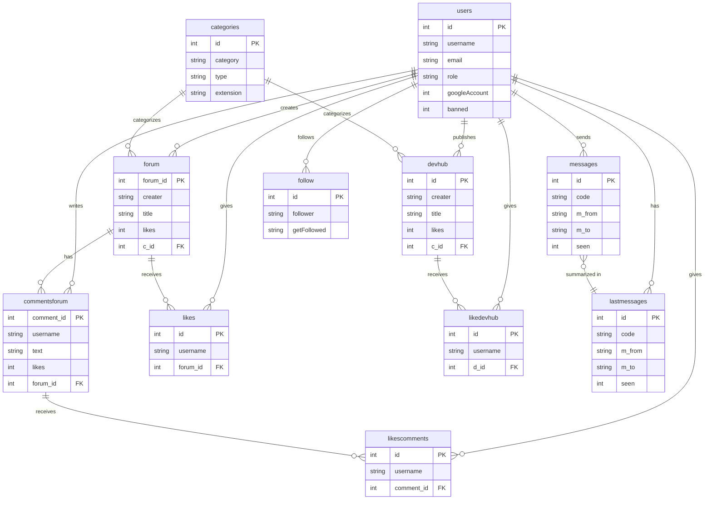

# 🦉 CodeOwl — Architecture & Database Design

> **Note:** This repository contains only the database schema and architectural documentation.  
> Source code is closed-source. This repo exists to showcase the system design and technical decisions.

---

## What is CodeOwl?

CodeOwl is a full-featured **developer community platform** built with PHP 8.x and MySQL. It allows developers to share code snippets, open-source projects, and communicate with each other through a forum and direct messaging system.

## Tech Stack

| Layer | Technology |
|---|---|
| Backend | PHP 8.x (Native) |
| Database | MySQL / MariaDB |
| Auth | Google OAuth 2.0 |
| Encryption | OpenSSL — AES-128-CBC |
| Security | Prepared Statements, MD5 file naming |

## Core Features

- **Forum** — Topic creation, code file uploads, like/dislike, comments
- **DevHub** — ZIP-based open-source project sharing with category filtering
- **Direct Messaging (DM)** — Private chat with read/unread tracking
- **Follow System** — User follow/unfollow with follower counts
- **RBAC** — Admin / Premium / Member roles
- **Admin Panel** — User moderation, ban/unban
- **Google OAuth 2.0** — Single sign-on with automatic account creation
- **AES-128-CBC Encryption** — Password encryption via OpenSSL

## Database Architecture

11 relational tables:

| Table | Purpose |
|---|---|
| `users` | User accounts with role, ban status, and Google auth flag |
| `categories` | Programming language categories with MIME type and extension |
| `forum` | Forum topics with uploaded code files |
| `commentsforum` | Comments on forum topics |
| `likes` | Forum topic likes |
| `likescomments` | Comment likes |
| `devhub` | Open-source project entries with ZIP files |
| `likedevhub` | DevHub project likes |
| `messages` | Direct messages with read/unread status |
| `lastmessages` | DM inbox summary |
| `follow` | User follow relationships |

## Key Technical Decisions

**DM Room Key:** Two usernames sorted alphabetically → joined → base64 encoded. Same room code regardless of who initiates.

**Duplicate Like Prevention:** Separate junction tables per content type prevent duplicate likes without complex locking.

**Cascade Username Update:** Username change propagates across all related tables in a single operation.

**File Security:** Files renamed with `md5(time() . $name)`. MIME type validated per category.

---

## ER Diagram

*Built by [Furkan Yaşar](https://linkedin.com/in/furkan-yasar0)*

---

# 🦉 CodeOwl — Mimari ve Veritabanı Tasarımı

> **Not:** Bu repo yalnızca veritabanı şemasını ve mimari dokümantasyonu içermektedir.  
> Kaynak kod kapalı kaynaklıdır.

---

## CodeOwl Nedir?

CodeOwl, PHP 8.x ve MySQL ile geliştirilmiş kapsamlı bir **yazılımcı topluluk platformudur**. Geliştiriciler kod parçacıklarını ve açık kaynak projelerini paylaşabilir, forum ve özel mesajlaşma sistemi üzerinden iletişim kurabilir.

## Teknoloji Yığını

| Katman | Teknoloji |
|---|---|
| Backend | PHP 8.x (Native) |
| Veritabanı | MySQL / MariaDB |
| Kimlik Doğrulama | Google OAuth 2.0 |
| Şifreleme | OpenSSL — AES-128-CBC |
| Güvenlik | Prepared Statements, MD5 dosya isimlendirme |

## Temel Özellikler

- **Forum** — Konu açma, kod dosyası yükleme, beğeni/beğenmeme, yorumlar
- **DevHub** — ZIP tabanlı açık kaynak proje paylaşımı
- **Özel Mesajlaşma (DM)** — Okundu/okunmadı takipli birebir mesajlaşma
- **Takip Sistemi** — Kullanıcı takip/takipten çıkma
- **RBAC** — Admin / Premium / Member rolleri
- **Admin Paneli** — Kullanıcı moderasyonu, ban/ban kaldırma
- **Google OAuth 2.0** — Tek tıkla giriş, otomatik hesap oluşturma
- **AES-128-CBC Şifreleme** — OpenSSL ile parola şifreleme

## Veritabanı Mimarisi

11 ilişkili tablo:

| Tablo | Amaç |
|---|---|
| `users` | Kullanıcı hesapları, rol, ban durumu, Google auth bayrağı |
| `categories` | Programlama dili kategorileri, MIME tipi ve uzantı |
| `forum` | Forum konuları ve yüklenen kod dosyaları |
| `commentsforum` | Forum yorumları |
| `likes` | Forum konusu beğenileri |
| `likescomments` | Yorum beğenileri |
| `devhub` | ZIP dosyalı açık kaynak proje girişleri |
| `likedevhub` | DevHub proje beğenileri |
| `messages` | Okundu/okunmadı durumlu özel mesajlar |
| `lastmessages` | DM gelen kutusu özeti |
| `follow` | Kullanıcı takip ilişkileri |

## Teknik Kararlar

**DM Oda Anahtarı:** İki kullanıcı adı alfabetik sıralanır → birleştirilir → base64 kodlanır. Kimin başlattığından bağımsız aynı oda kodu üretilir.

**Çift Beğeni Önleme:** Her içerik türü için ayrı junction tabloları çift beğeniyi önler.

**Cascade Kullanıcı Adı Güncelleme:** Kullanıcı adı değişikliği tüm ilişkili tablolara tek seferde yansır.

**Dosya Güvenliği:** Dosyalar `md5(time() . $name)` ile yeniden adlandırılır. MIME tipi kategoriye göre doğrulanır.

---

## ER Diagram

*Built by [Furkan Yaşar](https://linkedin.com/in/furkan-yasar0)*
